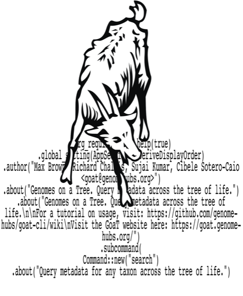

[](https://github.com/genomehubs/goat-cli/releases/)
[](https://anaconda.org/bioconda/goat)
[](https://anaconda.org/bioconda/goat)
[](https://anaconda.org/bioconda/goat)
[](https://crates.io/crates/goat-cli)

<p align="center">
    
</p>

# GoaT CLI

A command line interface for GoaT (Genomes on a Tree). GoaT presents metadata for taxa across the tree of life. 

The CLI here builds URLs to query the <b><a href="https://goat.genomehubs.org/api-docs/">Goat API</a></b>. The underlying API is very powerful, but complex. The aim of this CLI is to remove some of the complexity for the end user.

Please consult the <b><a href="https://github.com/genomehubs/goat-cli/wiki">wiki</a></b> for more information, tutorials, and examples.

For the full syntax of expressions (`-e`), including `OR`, lists, negation, functions and searching without a taxon, see <b><a href="EXPRESSIONS.md">EXPRESSIONS.md</a></b>.

## Install

Build from source to get everything on this page; the newest features (`--format`, `record`, sorting, `--tax-depth`, completions) are not in a release yet. With [Rust](https://rustup.rs/) installed:

```bash
cargo install --git https://github.com/genomehubs/goat-cli
goat-cli --version
```

Other ways, all older:

- **[Releases](https://github.com/genomehubs/goat-cli/releases/latest)** (0.2.53) have binaries for macOS, Linux and Windows. The Linux binary needs OpenSSL 1.1 (`libssl.so.1.1`), which current distributions no longer ship.
- **Bioconda** (`conda install -c bioconda goat`) and **crates.io** (`cargo install goat-cli`) are at 0.2.5.

## Output formats and records

Most commands take `-F/--format tsv|csv|json` (default `tsv`). Reports (`hist`, `scatter`, `arc`, `sources`) print tables, e.g. one row per histogram bin with a column per `-c` category; `-F json` gives GoaT's full response instead, as does `search` (with several taxa, one response with all their results).

`goat-cli taxon record -t "Homo sapiens"` (or a taxon ID) shows every field of a record with its value, count, aggregation and sources; `--names` and `--lineage` show its names or lineage instead. `goat-cli assembly record -t GCA_000001405.29` does the same for assemblies.

## Sorting and depth

`search` can sort its results with `--sort-by <field>` (any field, or `scientific_name`, `taxon_id`, `taxon_rank`, or `assembly_id` for assemblies) and `--sort-order asc|desc`, e.g. the largest primate genomes:

```bash
goat-cli taxon search -t Primates -d --tax-rank species -i -G --sort-by genome_size --sort-order desc --size 10
```

`--tax-depth <n>` (with `-d`) returns only taxa exactly `n` levels below each taxon, e.g. the subfamilies of Hominidae with `-t Hominidae -d -i --tax-depth 1`.

`taxon newick -n` builds a tree with only the given taxa as tips (they must be at `--rank`), rather than all their descendants.

## Shell completions

`goat-cli completions <shell>` prints a completion script for `bash`, `zsh`, `fish`, `elvish` or `powershell`, completing subcommands, flags and their values. For example:

```bash
# bash
goat-cli completions bash > ~/.local/share/bash-completion/completions/goat-cli
# zsh (with ~/.zfunc in your $fpath)
goat-cli completions zsh > ~/.zfunc/_goat-cli
# fish
goat-cli completions fish > ~/.config/fish/completions/goat-cli.fish
```

Then start a new shell.

## `goat-cli` documentation

If you fancy delving into the Rust code, I've had a first pass at documenting everything. Helped me iron out a few bugs too.

<p align="center"><b><a href="https://genomehubs.github.io/goat-cli/">API documentation</a></b></p>

## Misc

Please test `goat`. Please try and break `goat`. Please find bugs and tell me. Please send feature requests. Creating an issue in this repo is probably the best way to go!